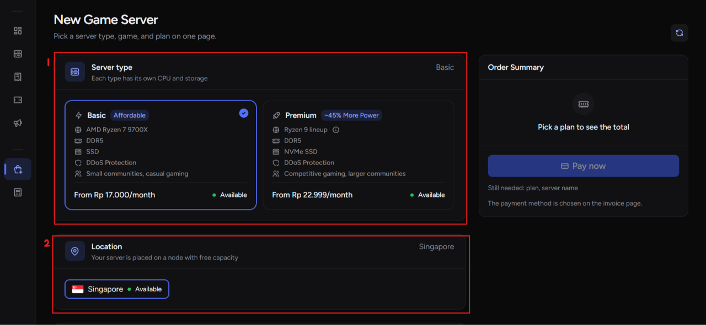
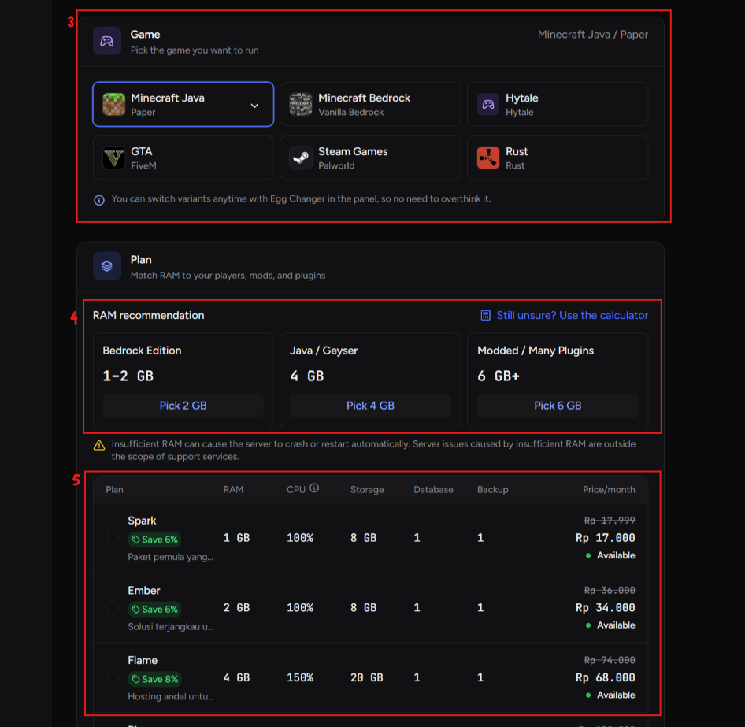
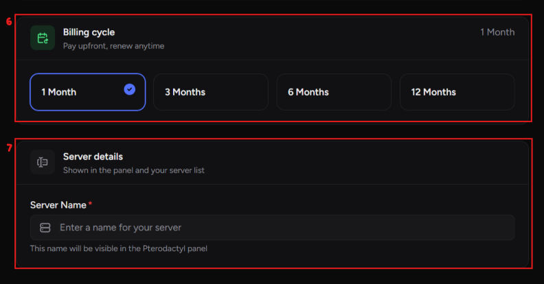
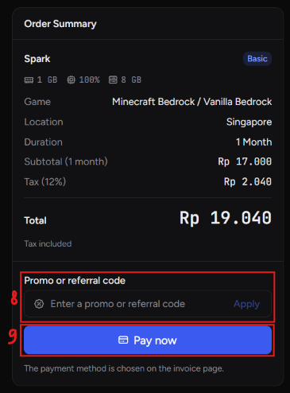
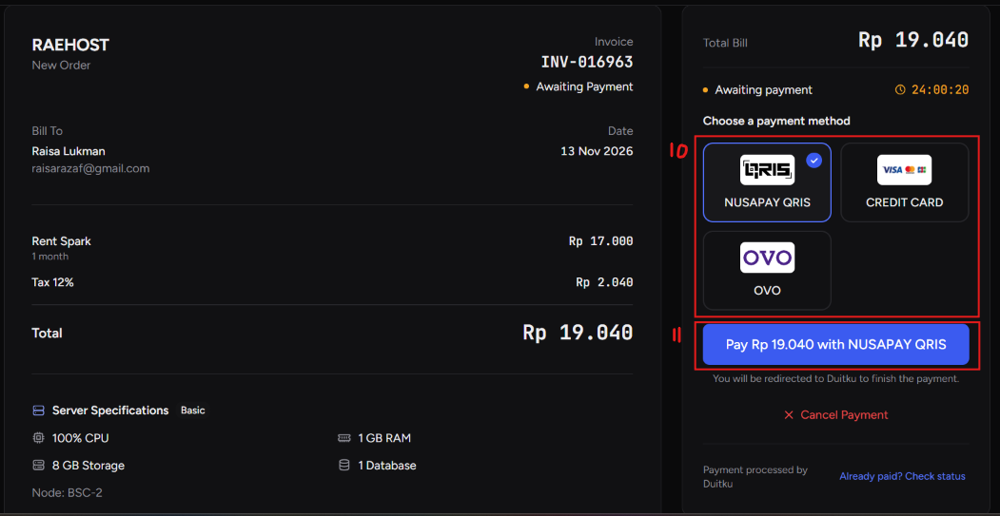

Untuk membeli server, user dapat masuk ke halaman [https://clients.raehost.com/order](http://clients.raehost.com/order)

<Steps>
  <Step title="Pilih Server Type dan Lokasi">
    <Frame>
      
    </Frame>

    1. User dapat memilih server type yang diinginkan. Bisa pilih paket basic atau premium. Penjelasan detail dapat diakses [disini](https://docs.raehost.com/basic-vs-premium)
    2. Pilih lokasi yang diinginkan (saat ini yang baru tersedia hanya Singapore)

  </Step>
  <Step title="Pilih Game Type dan Paket">
    Pilih paket yang kamu mau beli sesuai dengan spesifikasi yang kamu butuhkan.

    <Frame>
      
    </Frame>

    3. Pilih game type yang diinginkan. Untuk pilih spesifik egg yang dinginkan, bisa klik tombol panah. Game Type untuk Minecraft dapat dipilih mengikuti [ini](https://docs.raehost.com/panduan-memilih-server). **Nantinya kamu juga bisa ubah egg di website panel**, mengikuti [ini](https://docs.raehost.com/cara-ubah-egg)
    4. Jika memilih Minecraft Java atau Bedrock, akan ditampilkan rekomendasi RAM
    5. Pilih paket yang kamu inginkan

  </Step>
  <Step title="Isi Kebutuhan Server">
    <Frame>
      
    </Frame>

    6. Pilih billing cycle yang diinginkan. Nantinya kamu bisa perpanjang server mengikuti [ini](https://docs.raehost.com/renewal)
    7. Masukkan nama server yang kamu inginkan

  </Step>
  <Step title="Klik Checkout">
    Jika dirasa seluruh informasi nya sudah benar, bisa klik `Continue to Checkout` seperti yang ditunjukkan pada nomor 1 untuk melakukan pembayaran.

    <Frame>
      
    </Frame>

    8. Jika kamu memiliki kode promo, silahkan masukkan di bagian 8
    9. Jika sudah seluruhnya, bisa klik **Pay Now**

  </Step>
  <Step title="Lakukan Pembayaran">
    <Frame>
      
    </Frame>

    10. Pilih metode pembayaran yang diinginkan
    11. Klik Pay

  </Step>
  <Step title="Pembayaran Berhasil">
    <Frame>
      
    </Frame>

    Jika pembayaran berhasil, akan tampil seperti gambar diatas.

  </Step>
  <Step title="Server Sudah Jadi">
    Setelah bayar, server mu akan langsung jadi dan aktif. Servermu dapat dilihat pada [https://clients.raehost.com/server](https://clients.raehost.com/server)
  </Step>
</Steps>

<Tip>
  Video TikTok: [https://www.tiktok.com/@raehost.com/video/7619711261298691348](https://www.tiktok.com/@raehost.com/video/7619711261298691348?is_from_webapp=1&sender_device=pc&web_id=7637455778454062609)

Video YouTube:

  <iframe src="https://www.youtube.com/embed/bUep3NN3xMk" title="YouTube video player" frameborder="0" className="w-full aspect-video rounded-xl" allow="accelerometer; autoplay; clipboard-write; encrypted-media; gyroscope; picture-in-picture; web-share" allowfullscreen />
</Tip>
