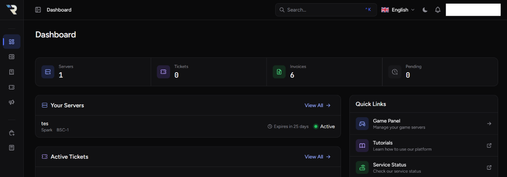
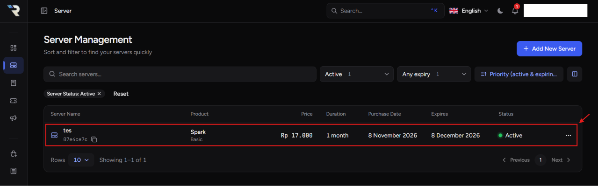
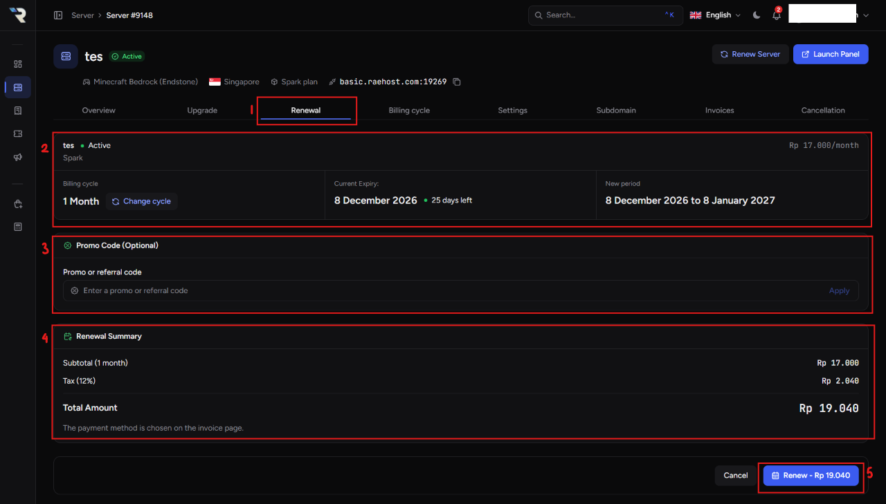
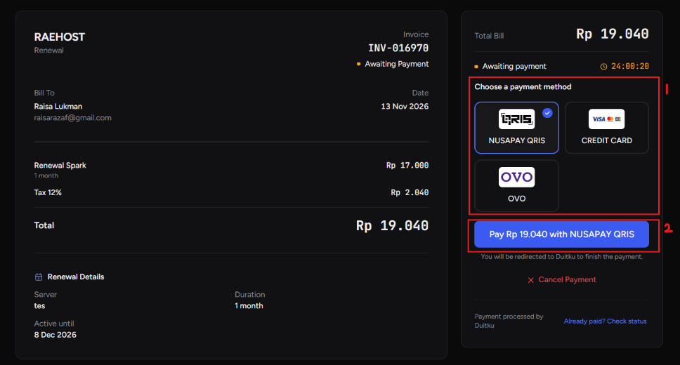

_Renew_ digunakan untuk memperpanjang masa aktif server agar server tetap online dan tidak terhapus oleh sistem.

## Cara _Renewal_ (Perpanjang) Server

<Steps>
  <Step title="Login ke Client Area">
    Masuk ke client area RaeHost melalui: [clients.raehost.com](http://clients.raehost.com) Login menggunakan akun RaeHost kamu.

    <Frame>
      
    </Frame>

  </Step>
  <Step title="Pilih Server">
    Buka menu **Server** atau klik [ini](https://clients.raehost.com/server), lalu pilih server yang ingin di-upgrade.

    <Frame>
      
    </Frame>

  </Step>
  <Step title="Klik Tab Renewal">

    <Frame>
      
    </Frame>
    1. Klik tab **Renewal**
    2. Menampilkan rincian servermu saat ini. Kamu dapat ubah siklus pembayaran melalui tombol **Change Cycle**
    3. Jika kamu memiliki kode promo, bisa diisi pada nomor 3
    4. Menampilkan rincian renewal server
    4. Klik **Renew**

  </Step>
  <Step title="Lakukan Pembayaran">
    <Frame>
      
    </Frame>
    1. Pilih metode pembayaran yang diinginkan
    2. Klik **Pay**
  </Step>
</Steps>

<Card title="Catatan Renewal" type="note">
  - Masa aktif dihitung dari tanggal expired sebelumnya, bukan dari tanggal
  pembayaran _renewal_ - _Renewal_ dapat dilakukan kapan saja sebelum server
  _expired_ - RaeHost memberikan toleransi hingga H\+3 setelah masa aktif habis
  - Jika server tidak diperpanjang melewati H\+3, server akan dihapus otomatis
  oleh sistem
</Card>

<Tip>
  Disarankan melakukan _renewal_ sebelum masa aktif habis untuk menghindari
  downtime atau penghapusan data server.
</Tip>
