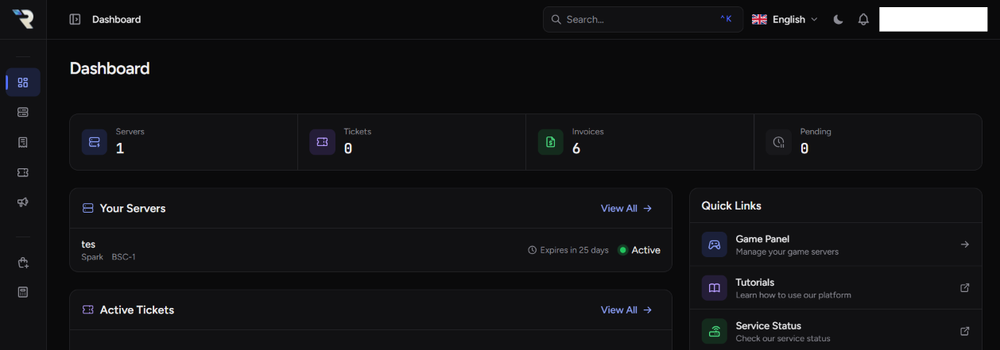
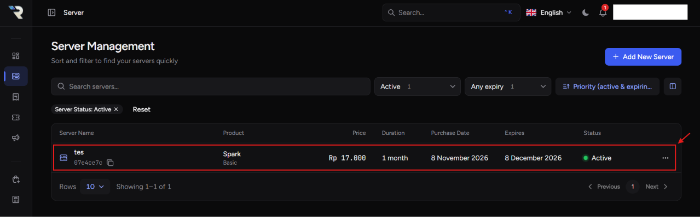
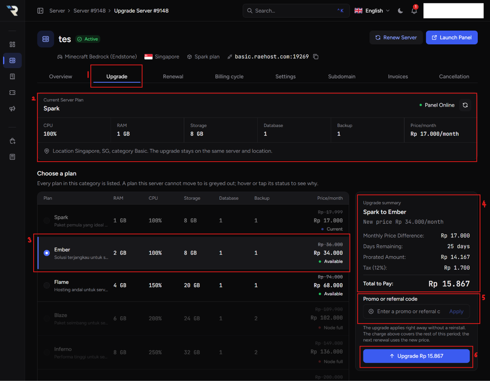
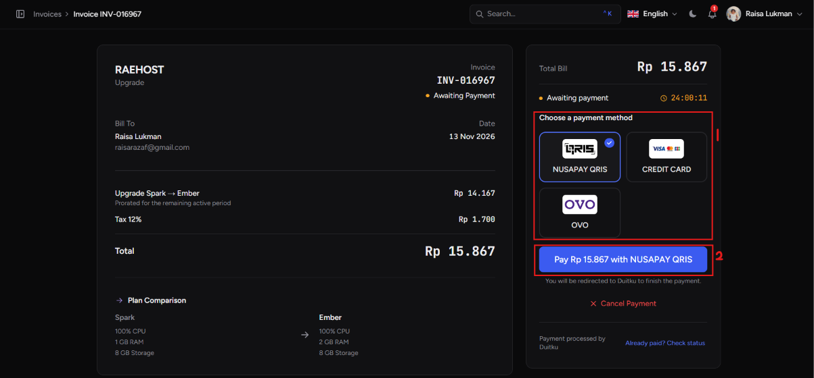

Kamu bisa meng-_upgrade_ paket server kapan saja sesuai kebutuhan. Upgrade cocok dipakai kalau server membutuhkan resource lebih besar, seperti RAM tambahan atau kapasitas player yang lebih banyak.

## Cara Upgrade Server

<Steps>
  <Step title="Login ke Client Area">
    Masuk ke client area RaeHost melalui [clients.raehost.com](https://clients.raehost.com), lalu login dengan akun RaeHost kamu.

    <Frame>
      
    </Frame>

  </Step>
  <Step title="Pilih Server">
    Buka menu **Server** atau klik [link ini](https://clients.raehost.com/server), lalu pilih server yang ingin di-upgrade.

    <Frame>
      
    </Frame>

  </Step>
  <Step title="Klik Tab Upgrade">
    <Frame>
      
    </Frame>

    1. Klik tab **Upgrade**.
    2. Bagian ini menampilkan rincian server kamu saat ini.
    3. Pilih paket upgrade yang kamu inginkan.
    4. Bagian ini menampilkan rincian lengkap proses upgrade.
    5. Kalau punya kode promo, isi di kolom ini.
    6. Klik **Upgrade**.

  </Step>
  <Step title="Lakukan Pembayaran">
    <Frame>
      
    </Frame>

    1. Pilih metode pembayaran yang kamu inginkan.
    2. Klik **Pay**.

  </Step>
</Steps>

<Note>
**Catatan Upgrade**

- **Upgrade hanya bisa dilakukan ke paket yang sejenis**, yaitu Basic ke Basic atau Premium ke Premium.
- Biaya upgrade dihitung dengan metode **prorata**:

  `(Harga Paket Baru - Harga Paket Lama) × (Sisa Hari / Total Hari)`

- Kamu hanya membayar selisih harga antara paket lama dan paket baru, sesuai sisa masa aktif server.
- Upgrade tidak menghapus world maupun data server.
- Server bisa langsung dipakai setelah pembayaran berhasil.
- Untuk cek info stok node, lihat channel `stock-hosting` di [Discord kami](https://discord.com/channels/845302933527855155/1418058696344342568).

</Note>
